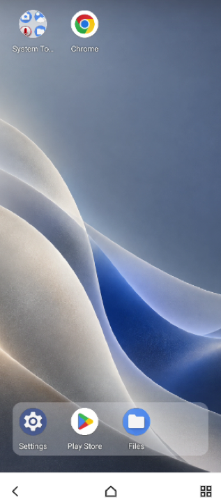

<p align="center">
  <picture>
    <source media="(prefers-color-scheme: dark)" srcset="assets/mobilerun-dark.png" />
    <source media="(prefers-color-scheme: light)" srcset="assets/mobilerun.png" />
    
  </picture>
</p>

<h1 align="center">mobilerun-android</h1>

<p align="center">
  <strong>Kotlin library for embedding Mobilerun device streams in Android apps.</strong><br />
  Live WebRTC video, remote input and task approvals, with optional Compose UI.
</p>

<div align="center">

<a href="https://docs.mobilerun.ai/partners">🤝 Partner guide</a>
·
<a href="https://docs.mobilerun.ai">📕 Documentation</a>
·
<a href="https://cloud.mobilerun.ai">☁️ Mobilerun Cloud</a>

[](#install)
[](#install)
[](LICENSE)
[](https://discord.gg/ZZbKEZZkwK)

[React](https://github.com/droidrun/mobilerun-react) · **Android** · [iOS](https://github.com/droidrun/mobilerun-swift) · [Flutter](https://github.com/droidrun/mobilerun-flutter)

</div>

> **Building Mobilerun phones into your platform?** Start with the [Partner guide](https://docs.mobilerun.ai/partners). It walks through the API key, one phone per user, stream keys and live viewing step by step.

<table>
<tr>
<td width="280" align="center">

</td>
<td>
<strong>In this package</strong>
<ul>
<li><code>DeviceStreamSession</code> — connection, recovery and stream state.</li>
<li><code>StreamCredentials</code> — target URL and per-connection token provider.</li>
<li><code>DeviceStreamView</code> — interactive video for View hosts.</li>
<li><code>DeviceStream</code> — Compose video and default navigation.</li>
<li><code>StreamTheme</code> — colors, typography and white-label tokens.</li>
<li><code>TaskApprovalController</code> — approval polling and decisions.</li>
<li><code>TaskApproval</code> — Compose approval card.</li>
</ul>
<strong>Requirements</strong>
<ul>
<li>Android 7.0+ (API 24); Android SDK 36 to build.</li>
<li>JDK 17 and Kotlin 2.4.21.</li>
<li>A Mobilerun API key on your server.</li>
</ul>
</td>
</tr>
</table>

## Install

The SDK is not published yet; use the source checkout today.
Clone this repository and open it in Android Studio, then add to an app module inside this checkout:

```kotlin
dependencies {
    implementation(project(":stream-compose"))
}
```

For a View host, use `project(":stream-android")` instead.
See [package and planned artifacts](docs/package.md) for module details and future Maven coordinates.

## Quick start

1. Your server mints a short-lived stream key for one device with your API key
   using `client.streamTokens.create`. Follow the [Partner guide](https://docs.mobilerun.ai/partners).
2. Your app's `tokenProvider` asks your server for a key before each connection.
3. The SDK opens the stream with that key, one key per connection, and reconnects with a fresh one.

On your Node server, install `@mobilerun/sdk@6.3.0` and keep `MOBILERUN_API_KEY` in the server environment.
Return a fresh key to the authorized app for every connection:

```js
import { MobilerunSDK } from '@mobilerun/sdk';

// Node server only. Authenticate the user and authorize this device before minting.
const client = new MobilerunSDK({
  apiKey: process.env.MOBILERUN_API_KEY,
  maxRetries: 0,
});
const allowedOrigins = ['https://app.example.com']; // optional browser origin policy
const { key, keyId, expiresAt } = await client.streamTokens.create({
  deviceId,
  ttlSeconds: 120,
  allowedOrigins,
});
res.writeHead(201, { 'Content-Type': 'application/json', 'Cache-Control': 'no-store' });
res.end(JSON.stringify({ key, keyId, expiresAt }));
```

REST fallback: `POST /v1/identity/stream-keys` with bearer API-key authentication on the server.

In your app, `backend` below is your own client for that server:

```kotlin
val scope = CoroutineScope(SupervisorJob() + Dispatchers.Default)
val session = DeviceStreamSession(context, credentials = {
    StreamCredentials(url = streamUrl, tokenProvider = { backend.mintStreamKey(deviceId) })
}, scope = scope)
session.start()
// Inside your composable:
StreamTheme { DeviceStream(session, Modifier.fillMaxSize()) }
// On screen disposal:
session.close(); scope.cancel()
```

To react to failures, collect `session.errors`: each failed attempt reports a `reason`
(`CredentialsUnavailable`, `TokenRejected`, `ConnectionRefused`, `Disconnected`, …), its `attempt`
and `final` once retries stop. See [Stream keys](docs/stream-keys.md#errors).
Every user-visible string comes from `StreamLabels`. The static `StreamCredentials(url, token)` form is legacy and deprecated: it reuses the same token on reconnect, so single-use keys need `tokenProvider`.

Never ship an API key in the app. Never cache keys or automatically retry mint requests.
For the runnable sample, see [TESTING.md](TESTING.md).

## Guides

Coding agents: use the [Mobilerun device stream skill](skills/mobilerun-device-stream/SKILL.md) for Kotlin integration.

| Guide | Covers |
|---|---|
| [Stream keys](docs/stream-keys.md) | Token provider, deadlines, secure URLs and legacy credentials |
| [Package](docs/package.md) | Modules, supported API, configuration and planned Maven artifacts |
| [Video and input](docs/video-and-input.md) | View and Compose hosts, touch, keyboard, IME and navigation |
| [Default UI](docs/default-ui.md) | Chrome, labels, themes and white-label slots |
| [Task approvals](docs/task-approvals.md) | Backend callbacks, polling, decisions and approval cards |
| [Lifecycle](docs/lifecycle.md) | Session ownership, visibility, network recovery and credentials |
| [Statistics](docs/stats.md) | Stream stats, benchmark and hardening checks |

## Contributing

See [CONTRIBUTING.md](CONTRIBUTING.md) for builds, tests, conformance fixtures and release guidance.
Report vulnerabilities privately as described in [SECURITY.md](SECURITY.md).

## License

[Apache-2.0](LICENSE).
